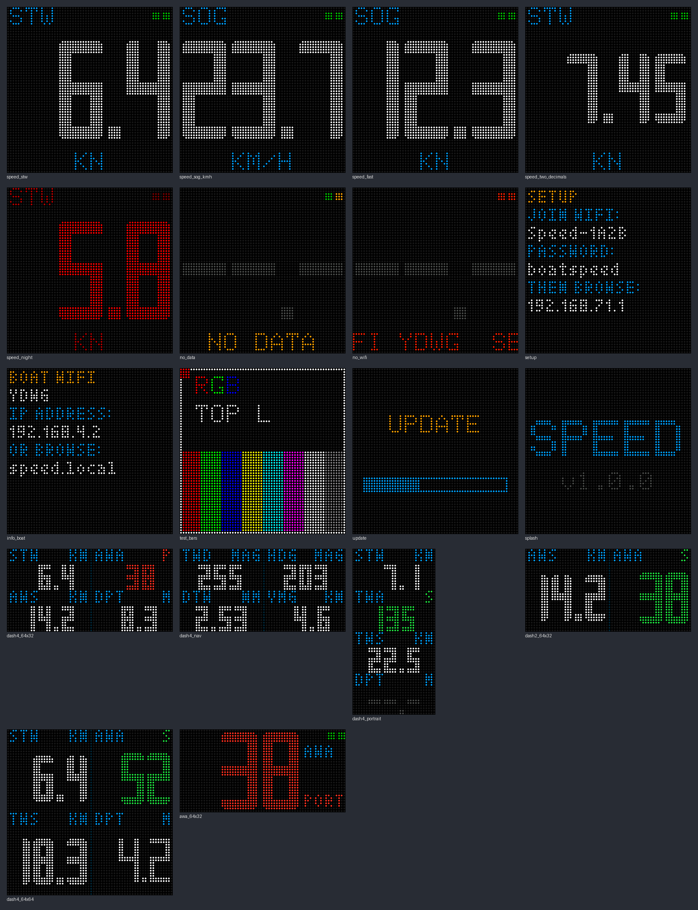

# Head-UP Marine Instrument Display

Displays a wide variety of boat speed, wind, heading, depth or navigation data
on a HUB75 LED matrix panel (64×64, 64×32 or chained), one value full-screen
or 2 or 4 at a time, read over Wi-Fi from an NMEA 2000 gateway (e.g. Yacht Devices YDWG-02,
YDNR-02, or anything else that serves NMEA 0183 or YD RAW on a TCP/UDP port).
Everything is set up from a web portal on your phone. No app or cloud is involved.



**Hardware.** One of these controller boards:

| Board | Build environment | Notes |
|---|---|---|
| Waveshare **ESP32-S3-RGB-Matrix** | `waveshare_s3_matrix` (default) | 32 MB octal flash, 16 MB PSRAM, one HUB75 output |
| Huidu **HD-WF4** (v7.x, ESP32-S3) | `huidu_hd_wf4` | 8 MB flash, no PSRAM, four HUB75 outputs in two pairs. See the [HD-WF4 flashing guide](docs/flashing-hd-wf4.md) |
| Adafruit **Matrix Portal S3** (5778) | `matrixportal_s3` | 8 MB flash, 2 MB PSRAM, one HUB75 socket. For 64×64 panels solder the E jumper to pin 8 |

Plus:

- A HUB75 RGB LED panel: 64×64, 64×32, or chained panels (setup in the portal)
- A 5 V supply sized for the panel. A 64×64 panel at full white draws several amps, so USB power alone is only good for a dim bench test.

Each board has its own firmware image, because their flash layouts differ.
Over-the-air updates refuse an image built for a different board.

## How it works

```
NMEA 2000 bus ─▶ NMEA 2000 gateway ──Wi-Fi──▶ ESP32-S3 ──HUB75──▶ LED panel
 (instruments)   192.168.4.1:1456                 joins the gateway's
                 NMEA 0183 or RAW                 network as a client
```

The display joins the gateway's Wi-Fi network and reads its NMEA server port.
It understands both data protocols Yacht Devices gateways offer:

| Value | NMEA 0183 | YD RAW (NMEA 2000) |
|---|---|---|
| STW speed through water | `VHW`, `VBW` | PGN 128259 |
| SOG speed over ground | `RMC`, `VTG`, `VBW` | PGN 129026 (and 128259's ground field) |
| AWA / AWS apparent wind | `MWV` (R), `VWR` | PGN 130306 (apparent) |
| TWA / TWS true wind | `MWV` (T), `VWT` | PGN 130306 (true, boat or water referenced) |
| TWD true wind direction | `MWD` | PGN 130306 (true or magnetic, north referenced) |
| HDG heading | `HDG`, `HDM`, `HDT`, `VHW` | PGN 127250 |
| COG course over ground | `RMC`, `VTG` | PGN 129026 |
| DTW distance to waypoint | `RMB`, `BWC` | PGN 129284 (fast packet) |
| BTW bearing to waypoint | `RMB`, `BWC` | PGN 129284 (fast packet) |
| VMG to wind | `VPW` | — (no standard PGN) |
| VMC to waypoint | `RMB` (closing velocity) | PGN 129284 |
| DPT depth | `DPT` (with offset), else `DBT` | PGN 128267 (with offset) |
| Clock (night schedule) | `RMC`, `ZDA` | PGN 126992 |

Bearings (HDG, COG, BTW, TWD) are shown **magnetic** or **true**, as chosen on
the Units tab. A value sent in the other reference is converted with the
magnetic variation from `RMC`/`HDG` or PGN 127250/127258; until a variation has
been seen it is not shown. Values are shown only as
the instruments send them: true wind and VMG are not calculated on the
display.

*Auto* accepts either. With several sensors on the bus you can choose which
device to trust, either by NMEA 2000 source address (RAW) or by talker ID (0183).

The display also runs its own Wi-Fi network for the setup portal at
`http://192.168.71.1`. That network deliberately avoids 192.168.4.x, which the
gateway uses. Once the display is on the boat network, the portal is also
reachable at `http://headup.local` or the display's IP address.

## Flashing

**Huidu HD-WF4:** follow [docs/flashing-hd-wf4.md](docs/flashing-hd-wf4.md). It
flashes through its USB-A socket, and the guide covers backing up Huidu's
firmware first.

**Waveshare ESP32-S3-RGB-Matrix** or **Adafruit Matrix Portal S3:**

1. Install [PlatformIO](https://platformio.org/install) (the VS Code extension, or `brew install platformio`).
2. Connect the board's USB-C port and run:

   ```bash
   pio run -e waveshare_s3_matrix -t upload   # Waveshare
   pio run -e matrixportal_s3 -t upload       # Matrix Portal S3
   ```

   If the upload can't connect, hold **BOOT**, tap **RST** (**RESET** on the
   Matrix Portal), release **BOOT**, and try again. The Matrix Portal's
   CircuitPython and UF2 bootloader are overwritten; Adafruit's site has the
   factory reset image if you want them back.
3. Optional serial log:

   ```bash
   pio device monitor
   ```

The web portal is compiled into the firmware (`scripts/embed_web.py` gzips
`web/index.html` on every build), so there is no filesystem image to upload.
Later updates can be uploaded from the portal's **System** tab: pick
`.pio/build/<environment>/firmware.bin` for your board.

## First-time setup

1. Power up. The panel shows **SETUP** with the display's network name
   (`HeadUp-XXXX`), its password (`headupdisplay` by default) and `192.168.71.1`.
2. Join that network from your phone. The portal usually opens by itself; if
   not, browse to `http://192.168.71.1`.
3. **Wi-Fi** tab: tap **Scan for networks** and pick the gateway. Yacht Devices
   networks are tagged **YD**. For an open network, tick *Open network*;
   otherwise enter its password. Press **Save & connect**.
4. Check the **Live** tab. The setup checklist turns green step by step, and
   the panel shows the speed (or whatever the Display tab's layout selects):

   1. Join the boat Wi-Fi
   2. Reach the gateway
   3. Receive NMEA data
   4. Find instrument data

With a gateway on factory settings, nothing else needs changing. The display
defaults to TCP, port 1456, *Automatic* gateway address, and *Auto* protocol,
which matches Server #1 out of the box.

### Gateway settings worth knowing

Configure these in the gateway's own web page, `http://192.168.4.1` (login
`admin` / `admin` unless changed), under **NMEA Server**:

- **TCP allows 3 clients per server port.** If chart-plotter apps already use
  Server #1, give the display its own server, or switch to **UDP**, which has
  no client limit. Then set the same transport and port on the display's
  **Data** tab.
- **NMEA 0183** needs the transmit filter to let through the sentences for the
  values you show (see the table above).
- **RAW** sends NMEA 2000 frames unfiltered, which makes it the most reliable
  choice when several devices are on the bus.
- **Client mode:** if the gateway is joined to a boat router instead of running
  its own access point, join the display to the router and enter the
  gateway's IP on the **Data** tab. **Find gateway** scans the network for
  open data ports.

The **Data** tab shows the raw lines arriving from the gateway, with lines
that carry values highlighted. This is the quickest way to see what the gateway actually
sends.

## Portal tabs

| Tab | What it does |
|---|---|
| Live | Current speed, every instrument value, live LED preview, setup checklist, every data source seen on the bus |
| Wi-Fi | Boat network (with scan); setup network name, password, always-on vs fallback, hostname |
| Data | TCP/UDP, gateway address and port, NMEA 0183 / RAW / Auto, gateway discovery, connection stats, live data view |
| Units | STW vs SOG for *Boat speed* (with fallback), speed units (kn, km/h, mph, m/s), depth units (m, ft), distance units (NM, km, mi) with optional m/yd/ft for distances under 1000 of those, magnetic or true bearings, decimals, smoothing, stale timeout, per-device source selection |
| Display | Layout (1, 2 or 4 sections) and the value in each, brightness, colours, rotation, which labels to show, night mode (manual or scheduled), test pattern |
| Panel | HUB75 driver chip, colour order, clock speed and phase, panel size and chaining; GPIO pins (Waveshare, Matrix Portal) or output connector (HD-WF4). Needs a reboot |
| System | Firmware info, OTA update, settings export and import, reboot, factory reset |

## The panel

**Layout** (Display tab): 1, 2 or 4 sections, each showing one of *Boat
speed* (STW or SOG per the Units tab), STW, SOG, AWA, AWS, TWA, TWS, TWD, HDG,
DTW, BTW, COG, VMG, VMC or DPT. The split follows the panel's shape after rotation:

| Panel (after rotation) | 2 sections | 4 sections |
|---|---|---|
| 64×32 landscape | side by side, 32×32 | 2×2 grid of 32×16 |
| 32×64 portrait (rotation 90°/270°) | stacked, 32×32 | 4 rows of 32×16 |
| 64×64 | stacked, 64×32 | 2×2 grid of 32×32 |
| 128×32 (two chained) | side by side, 64×32 | 4 columns of 32×32 |

Each section has a small label top left (`STW`, `AWA`, …), the unit top right,
and the value below. Wind angles show 0–180° with **P**/**S**, the digits
tinted red for port and green for starboard (single colour in night mode).
Headings and TWD show three digits (`005`). Sections without data show
dashes. While Wi-Fi, the gateway link or the data stream is down, the panel
switches to the full-screen layout with a scrolling problem description.

**Full-screen layout** (1 section):

- **Big digits**: the value. The digit slots stay fixed, so 9.9 → 10.0 doesn't
  change the digit size.
- **Top left**: the label (`STW`/`SOG` for *Boat speed*, whichever is shown).
- **Top right**: two status dots, Wi-Fi then data. Green means OK, amber means
  connected but no value yet, red means down.
- **Bottom line**: the unit (`PORT`/`STBD` for wind angles), or a scrolling
  problem description (`NO WIFI …`, `NO LINK …`, `NO DATA`, `NO SPEED DATA`,
  `NO AWA DATA` …).

On short panels (64×32), the labels move to a narrow column on the right so the
digits can use the full height.

## Button

The **BOOT** button on the Waveshare board, **S1** on the HD-WF4, or **UP** on the Matrix Portal S3:

| Press | Action |
|---|---|
| Short (< 1 s) | Toggle night mode (dim, single colour; red by default) |
| Hold 3 s, release | Show connection info on the panel for 30 s, and turn on the setup network for 15 min |
| Hold 10 s | Factory reset |

## Troubleshooting

| Symptom | Try |
|---|---|
| Panel dark or garbled | **Panel** tab: driver *FM6126A*, then *Generic*; lower the clock speed; check the panel's 5 V supply |
| Rows doubled, interleaved or in 8-row blocks | The panel is 1/8 scan (often marked *8S*): **Panel** → Scan rate → *1/8 scan*, then try *alternate row order* |
| Colours wrong in the test pattern | **Panel** → Colour order |
| Upside down / sideways | **Display** → Rotation |
| "network not found" | Is the gateway in access point mode and in range? Its SSID is case-sensitive |
| Reaches Wi-Fi, "no answer from 192.168.4.1:1456" | The server port is off, or 3 TCP clients are already connected. Use another server or UDP |
| Data flows but "NO SPEED DATA" | Check the 0183 transmit filters, or switch to RAW; make sure the Units tab's source mode allows the speed that exists (STW vs SOG) |
| A section shows dashes | The bus doesn't carry that value: the **Live** tab lists what arrives. Check the gateway's 0183 transmit filters, or use RAW. A bearing sent only in the other reference (true vs magnetic) needs a magnetic variation (`RMC`, `HDG`, PGN 127258) |
| VMG stays empty with RAW | NMEA 2000 has no standard VMG message; use NMEA 0183 with `VPW` from your instruments |
| Phone keeps dropping the setup network | While the display can't find the boat Wi-Fi it scans for it, which moves its own network between channels. Set up the boat Wi-Fi first, or set the setup network to *fallback* |

## Development

```bash
pio run -e waveshare_s3_matrix -e huidu_hd_wf4 -e matrixportal_s3   # build all boards
pio test -e native                       # parser / model / item unit tests on the host
tools/preview/build.sh                   # host build of the panel renderer
python3 tools/preview/render_png.py      # regenerate docs/panel/*.png
python3 tools/mock_device.py --fresh     # portal against a fake device: http://127.0.0.1:8765
python3 tools/mock_device.py --board wf4 # ... pretending to be an HD-WF4
python3 tools/mock_device.py --board matrixportal # ... or a Matrix Portal S3
python3 tools/yd_simulator.py            # fake YD gateway on TCP 1456 (NMEA 0183): speed, wind, heading, depth, waypoint
python3 tools/yd_simulator.py --protocol raw --transport udp --port 1457
```

To bench-test the real display without the boat, run `yd_simulator.py` on a
laptop. Join the display and the laptop to the same network, then enter the
laptop's IP and port on the display's **Data** tab.

`tools/decode/decode.cpp` runs the firmware's decoder against any stream, for
example `nc 192.168.4.1 1456 | tools/decode/decode`. Build it with the command
at the top of that file.

### Layout

```
lib/BoatData/     portable NMEA 0183 + YD RAW parsers, the boat model and the display items (unit-tested)
src/
  Board.*         per-board pins, defaults, button/LED, HD-WF4 output ports
  main.cpp        boot, render loop, night schedule, button
  BoatWifi.*      station link to the gateway + setup access point
  DataLink.*      TCP/UDP reader task, live data view, gateway discovery
  Portal.*        HTTP API + captive portal
  Settings.*      settings model, JSON validation, NVS storage
  Renderer.*      all panel screens (hardware-free; also builds on the host)
  Display.*       HUB75 driver glue
web/index.html    the portal (embedded at build time)
tools/            simulator, mock device, preview renderer, decoder CLI
```

HUB75 pin map for the Waveshare board, taken from Waveshare's examples:
R1 4, G1 5, B1 6, R2 7, G2 15, B2 16, A 18, B 8, C 3, D 42, E 9, LAT 40, OE 2, CLK 41.
Matrix Portal S3, from Adafruit's Protomatter examples:
R1 42, G1 41, B1 40, R2 38, G2 39, B2 37, A 45, B 36, C 48, D 35, E 21, LAT 47, OE 14, CLK 2.
The HD-WF4 map is in its [flashing guide](docs/flashing-hd-wf4.md#how-the-four-outputs-work).
